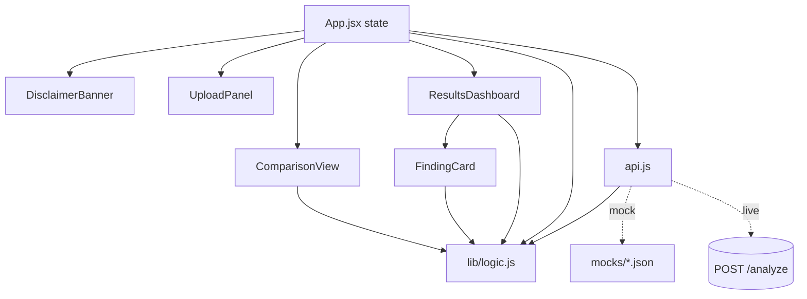
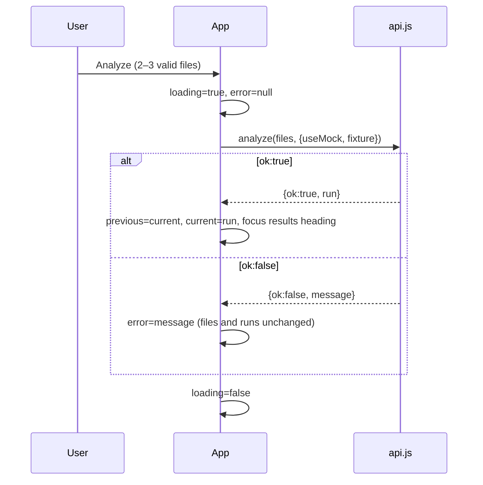

# Design Document: regulens-frontend

## Overview

The BioLyze frontend is a single-page React app in `frontend/` that uploads 2–3 PDF files to `POST /analyze`, validates the response, and renders either a severity-grouped findings dashboard (Completed_Result) or an extraction-only view (Extracted_Only_Result). It supports JSON download, rerun with different files, a counts-only comparison of two completed runs, and a Mock_Mode that returns one of two local fixtures.

Design goals for the seven-hour MVP:

- Smallest workable structure: one state owner (`App.jsx`), one network module (`api.js`), one module of pure helpers (`lib/logic.js`), and five presentational components.
- All decision logic (file validation, response classification, grouping, citation placeholders, export) lives in pure functions so it can be tested without a browser.
- Backend text is always rendered as plain text through JSX.
- Nothing is persisted; nothing secret is read.

Contract source of truth: root `README.md` (findings contract and extraction-only scaffold). Items not yet agreed are listed in [Unresolved Backend Dependencies](#unresolved-backend-dependencies).

## Architecture

Stack: plain JavaScript, React, Vite, Tailwind CSS v4 via `@tailwindcss/vite` (CSS entry contains `@import "tailwindcss";`), native `fetch` and `FormData`. No router, state library, UI kit, chart library, or animation library.

```
frontend/
├── .env.example              # VITE_API_BASE_URL, VITE_USE_MOCK only
├── vite.config.js            # react() + tailwindcss() plugins; Vitest config
└── src/
    ├── main.jsx              # createRoot, renders <App />
    ├── index.css             # @import "tailwindcss";
    ├── App.jsx               # state owner, orchestration
    ├── api.js                # analyze(): live fetch or mock fixture
    ├── lib/logic.js          # pure helpers (validation, grouping, views, export)
    ├── components/
    │   ├── DisclaimerBanner.jsx
    │   ├── UploadPanel.jsx
    │   ├── ResultsDashboard.jsx   # completed, extraction-only, unsupported-status views
    │   ├── FindingCard.jsx
    │   └── ComparisonView.jsx
    └── mocks/
        ├── flawed.json
        └── corrected.json
```

### Component diagram



### Analyze flow



Retry is simply pressing Analyze again; there is no separate retry path.

## Components and Interfaces

### `src/App.jsx`

Owns all state with `useState` (one small `useReducer` is an acceptable alternative). Reads environment once at module scope:

```js
const API_BASE_URL = import.meta.env.VITE_API_BASE_URL || 'http://localhost:8000';
const USE_MOCK = import.meta.env.VITE_USE_MOCK === 'true';
```

These are the only environment reads in the app (Req 14.3).

Handlers:

- `onAddFiles(fileList)` → `addFiles(selected, fileList)`; sets `selectedFiles` and `fileErrors`.
- `onRemoveFile(index)` → removes one entry.
- `onAnalyze()` → guarded by `canAnalyze(selectedFiles) && !loading`; calls `analyze`, then applies the Run transition or sets `error`.
- `onRunAgain()` → clears `selectedFiles` and `fileErrors` only; Current_Run stays visible (Req 10.2).
- `onClear()` → clears `selectedFiles`, `current`, `previous`, `error` (Req 10.8).
- `onDownload()` → `serializeReport(current.result)` → Blob → temporary object URL on an `<a download="regulens-report.json">`, clicked then revoked.

After a successful run, a `useEffect` keyed on `current` focuses the results summary heading (`tabIndex={-1}`, via ref) (Req 13.5).

Render order (single column): `DisclaimerBanner`, page `<h1>`, `UploadPanel`, loading region, error alert, `ComparisonView` (when eligible), `ResultsDashboard` (when `current` exists).

Loading region: `<div aria-live="polite">` that contains the text "Analyzing documents" while `loading` is true (Req 4.1, 4.2). Error region: `<div role="alert">` rendered only when an Error_Message exists (Req 5.4).

### `src/api.js`

```js
// returns {ok:true, run} | {ok:false, message}
export async function analyze(files, { useMock, fixture, baseUrl })
```

- Mock path (`useMock === true`): returns the fixture named by `fixture` (`"flawed"` | `"corrected"`) from statically imported `mocks/flawed.json` / `mocks/corrected.json`. No `fetch` call. It never chooses a fixture on its own and never switches fixtures (Req 11.2, 11.4). The fixture still passes through `validateResponse` so it is classified the same way as live data.
- Live path: builds `FormData`, appending each file under `files`; calls `fetch(`${baseUrl}/analyze`, { method: 'POST', body: form })` with no `headers` option (Req 2.1, 2.2, A1). The live path contains no fixture references, so a live failure cannot produce mock data (Req 11.6).
  - `fetch` rejects → `{ok:false, message: networkErrorMessage(baseUrl)}`.
  - Non-2xx → read body as text, try `JSON.parse`; `{ok:false, message: httpErrorMessage(status, statusText, body)}`.
  - 2xx → read text, `JSON.parse` (failure → "Response format not recognized"); then `validateResponse(body)`:
    - `completed` / `extracted_only` → `{ok:true, run: {result: body, kind, filenames}}`.
    - `unsupported` → `{ok:false, message: unsupportedStatusMessage(body.status)}`.
    - `invalid` → `{ok:false, message: "Response format not recognized"}`.
- `filenames` is `files.map(f => f.name)` captured from the submitted `File` objects before the request (Req 2.4).

Design note: an unsupported status is returned as `ok:false`, so it is shown in the error alert and the existing runs are preserved. `ResultsDashboard` also has an unsupported-status branch for defensive rendering if a Run with `kind:'unsupported'` is ever passed in; in normal flow it is not reached.

### `src/lib/logic.js` (pure, no React, no DOM)

| Function | Purpose | Reqs |
|---|---|---|
| `PER_FILE_LIMIT = 10 * 1024 * 1024`, `MAX_FILES = 3`, `MIN_FILES = 2` | Constants | 1.5, 1.6, A6 |
| `isSupportedExtension(name)` | `/\.(pdf|txt)$/i` | 1.4 |
| `validateFile(file)` → `null \| message` | Extension, then size; messages name the file (and the 10 MB limit for size) | 1.4, 1.5 |
| `addFiles(selected, incoming)` → `{files, errors}` | Validates each incoming file, appends valid ones until 3, emits a 3-file-maximum message if any were dropped for count | 1.4–1.6 |
| `canAnalyze(files)` → boolean | `2 <= length <= 3` and every file passes `validateFile` | 1.7, 1.8 |
| `requiredCountMessage(files)` | e.g. "Select at least 2 files (1 selected)" | 1.8 |
| `validateResponse(body)` → `{kind}` | See below | 3.1–3.5 |
| `httpErrorMessage(status, statusText, body)` | `detail` present and readable → `"<detail> (HTTP <status>)"`; otherwise `"Request failed: HTTP <status> <statusText>"`. Non-string `detail` (FastAPI validation arrays) is `JSON.stringify`-ed | 5.1, 5.2 |
| `networkErrorMessage(baseUrl)` | `"Could not reach the backend at <baseUrl>"` | 5.3 |
| `unsupportedStatusMessage(status)` | `"Unsupported response status: <String(status)>"` | 3.4 |
| `normalizeSeverity(raw)` → `'high'\|'medium'\|'low'\|'other'` | Case-insensitive, trims; non-string → `'other'` | 6.2, 6.3 |
| `groupBySeverity(findings)` → `[{key, label, findings}]` | Order high, medium, low, Other; omits empty groups; stable within group | 6.2–6.4 |
| `summarizeRun(run)` → `{total, counts:{high,medium,low,other}, documentsAnalyzed, filenames}` | Shared by dashboard and comparison | 6.1, 10.4 |
| `citationView(source)` → `{filename, page, quote}` | Missing `page` → "Page not provided"; missing `quote` → "Quote not provided"; present quote returned unchanged | 7.3–7.7 |
| `fieldOrNotProvided(value)` | Missing/empty → "Not provided" | 7.9 |
| `guidanceView(ref)` → `null \| {text, label}` | `null`/`undefined` → `null`; otherwise `text` is the value as provided (strings unchanged, non-strings `JSON.stringify`-ed) and `label = guidanceLabel(ref)` | 7.11–7.13 |
| `guidanceLabel(ref)` → `null \| "Draft guidance (nonbinding)"` | Single isolated rule; returns `null` until the source-identity metadata shape is agreed (A7) | 7.12, 7.13 |
| `serializeReport(result)` | `JSON.stringify(result, null, 2)` of the exact parsed object | 9.2, 9.3 |
| `REPORT_FILENAME = 'regulens-report.json'` | Constant | 9.2 |
| `isComparable(previous, current)` | Both exist and both `kind === 'completed'` | 10.4, 10.5 |

`validateResponse(body)` applies a separate check per status:

```js
if (body === null || typeof body !== 'object' || Array.isArray(body)) return { kind: 'invalid' };
if (body.status === 'completed')
  return Number.isInteger(body.documents_analyzed) && Array.isArray(body.findings)
    ? { kind: 'completed' } : { kind: 'invalid' };
if (body.status === 'extracted_only')
  return Array.isArray(body.documents) ? { kind: 'extracted_only' } : { kind: 'invalid' };
if (!('status' in body)) return { kind: 'invalid' };
return { kind: 'unsupported' };
```

Only `status === "completed"` can yield `kind: 'completed'`. Each element of `findings` is not deep-validated; missing Finding fields are handled by placeholders in the card (Req 7.6–7.9), which keeps any contract-conforming result renderable without code changes (Req 6.7).

`guidanceLabel` is deliberately the only place the draft-guidance label rule lives. Pending backend agreement on the metadata shape (A7), it returns `null` for every input, so references display without a label (Req 7.13). Once agreed, only this function and its test change.

### `src/components/DisclaimerBanner.jsx`

Static text shown on every view (Req 12.1–12.3): preliminary evidence-integrity audit; not an FDA approval prediction or regulatory compliance certification; severity is a triage label, not a regulatory risk determination; demo documents are synthetic and fictional. Rendered as a `<section aria-label="Disclaimer">` at the top of the page.

### `src/components/UploadPanel.jsx`

Props: `files, errors, loading, canAnalyze, requiredMessage, useMock, fixture, onFixtureChange, onAdd, onRemove, onAnalyze, hasRun, onRunAgain, onClear`.

- `<h2>` "Upload documents".
- `<label for>` + `<input type="file" multiple accept=".pdf,.txt">` (Req 1.1, 13.2). The input value is reset after each change so the same file can be re-added.
- List of files with name and human-readable size, each with a `<button aria-label="Remove <name>">` (Req 1.2, 1.3).
- File errors listed inside a `role="alert"` region.
- Required-count message when fewer than 2 files (Req 1.8).
- Mock_Mode only: `<label>` + `<select>` with "Flawed sample" (`flawed`) and "Corrected sample" (`corrected`); value changes only on user input (Req 11.3, 11.4).
- Analyze `<button>` disabled when `!canAnalyze || loading` (Req 1.7, 1.8, 4.3).
- When `hasRun`: "Run again with different files" and "Clear results" buttons (Req 10.1, 10.2, 10.8).

### `src/components/ResultsDashboard.jsx`

Props: `run, isMock, headingRef, onDownload`. Three branches on `run.kind`:

- `completed`: `<h2 ref tabIndex={-1}>` "Results summary"; documents analyzed, total findings; "Demo data" label if `isMock` (Req 11.5); "Download JSON report" button (Req 9.1). If zero findings: "No findings were flagged in the uploaded package" plus "This result is not a compliance certification." (Req 6.6). Otherwise for each group from `groupBySeverity`: `<h3>` with text label and count (e.g. "High (2)"), color as a secondary cue only (Req 6.4, 6.5), then `FindingCard`s.
- `extracted_only`: same heading, download button, and Demo data label; notice "Text extraction only: findings analysis has not run."; list of each document's `filename` and `pages.length` (missing `pages` treated as 0) (Req 8.1, 8.2). No findings or severity groups are rendered (Req 3.5).
- `unsupported` (defensive): "Unsupported response status" with the raw status; nothing else.

No approval probabilities, scores, or badges (Req 12.4).

### `src/components/FindingCard.jsx`

Props: `finding`. An `<article>` with `<h4>` title (`fieldOrNotProvided`), plus `id`, severity text label (raw value shown when group is Other, Req 6.3), `type`, explanation, "Recommended action: …" (Req 7.1, 7.9).

- `review_required === true` → "Human review required" (Req 7.2).
- `type === 'unsupported_claim'` → the fixed evidence-absence note (Req 7.10).
- Sources: if missing/empty → "No source citation provided" (Req 7.8); else one entry per source via `citationView`, quote in a `<blockquote>` with `whitespace-pre-wrap` so characters are preserved (Req 7.3–7.7). Only response sources are rendered (Req 7.5).
- Guidance: if `guidanceView` is non-null, show text, plus the label when present (Req 7.11–7.13).

All values are rendered as JSX text children; `dangerouslySetInnerHTML` is not used anywhere (Req 14.2). Non-string values passed to text slots are converted with `String()`.

### `src/components/ComparisonView.jsx`

Props: `previous, current`. Rendered by App only when `isComparable(previous, current)` (Req 10.4, 10.5). Two side-by-side columns ("Previous run", "Current run") stacking to one column on narrow screens, each showing `summarizeRun` output: total, high/medium/low/Other counts, documents analyzed, filenames. Counts only; no per-finding status (Req 10.6). Fixed note: "Issue-level comparison requires a stable issue identity guaranteed by the backend." (Req 10.7).

### Styling, accessibility, layout

- Tailwind utilities only. Container `mx-auto max-w-3xl px-4`, single column; long text uses `break-words` so 320 px widths never scroll horizontally (Req 13.6). Comparison uses `grid sm:grid-cols-2`.
- Native `<button>`, `<input>`, `<select>` for keyboard operability; `focus-visible:outline` styles on all controls (Req 13.1).
- Heading hierarchy: `h1` page title, `h2` upload and results summary (and comparison), `h3` severity groups, `h4` finding titles (Req 13.3).
- Body text `text-slate-900` on white/`slate-50`, severity chips use dark text on light tints (for example `bg-red-100 text-red-900`) to keep at least 4.5:1 (Req 13.4).

## Data Models

```js
// Run (App state)
{ result: object,                  // exact parsed response body
  kind: 'completed' | 'extracted_only',
  filenames: string[] }            // from submitted File objects

// App state
{ selectedFiles: File[], fileErrors: string[],
  loading: boolean, error: string | null,
  fixture: 'flawed' | 'corrected',  // used only in Mock_Mode, default 'flawed'
  current: Run | null, previous: Run | null }

// analyze() result
{ ok: true, run: Run } | { ok: false, message: string }

// validateResponse() result
{ kind: 'completed' | 'extracted_only' | 'unsupported' | 'invalid' }
```

Run transitions:

| Event | `previous` | `current` | `selectedFiles` |
|---|---|---|---|
| Analyze success, no current | unchanged (null) | new Run | unchanged |
| Analyze success, current exists | old current | new Run | unchanged |
| Analyze failure | unchanged | unchanged | unchanged |
| Run again | unchanged | unchanged | cleared |
| Clear results | null | null | cleared |

Response shapes follow README: Completed_Result `{status:"completed", documents_analyzed, findings:[Finding]}`; Extracted_Only_Result `{status:"extracted_only", documents:[{filename, pages:[{page, text}]}], findings:[]}`. Finding fields: `id, type, severity, title, explanation, sources:[{filename, page, quote}], guidance_reference, action, review_required`.

Mock fixtures `src/mocks/flawed.json` and `src/mocks/corrected.json` are hand-written Completed_Results in the README contract, authored inside `frontend/` and not imported from `samples/` (Req 11.7). `flawed.json` has several findings across severities, including one `unsupported_claim` and one non-null `guidance_reference`; `corrected.json` has fewer findings (possibly zero). All values are fictional.

`frontend/.env.example`:

```
VITE_API_BASE_URL=http://localhost:8000
VITE_USE_MOCK=false
```

## Correctness Properties

*A property is a characteristic or behavior that should hold true across all valid executions of a system-essentially, a formal statement about what the system should do. Properties serve as the bridge between human-readable specifications and machine-verifiable correctness guarantees.*

The set is kept small for the MVP. Overlapping criteria were merged: file rules (1.4–1.8) into one property, status classification (3.1–3.5) into one, grouping and counts (6.1–6.4) into one, and citation rendering (7.3–7.5, 14.2) into one.

### Property 1: File selection invariants

*For any* current selection and any sequence of incoming files with arbitrary names and sizes, `addFiles` returns a selection that (a) contains at most 3 files, (b) contains only files whose names end in `.pdf`/`.txt` case-insensitively and whose size is at most 10 × 1024 × 1024 bytes, (c) emits an error naming each rejected file (and the 10 MB limit for size rejections, or the 3-file maximum for count overflow); and `canAnalyze` is true exactly when the selection has 2 or 3 files that all pass validation.

**Validates: Requirements 1.4, 1.5, 1.6, 1.7, 1.8**

### Property 2: Response classification never promotes non-completed bodies

*For any* JSON value, `validateResponse` returns `completed` only when `status === "completed"`, `documents_analyzed` is an integer, and `findings` is an array; returns `extracted_only` only when `status === "extracted_only"` and `documents` is an array; returns `unsupported` for any other present `status`; and otherwise returns `invalid`. In particular, no body with `status` other than `"completed"` is ever classified `completed`.

**Validates: Requirements 3.1, 3.2, 3.3, 3.4, 3.5**

### Property 3: Severity grouping is an ordered partition

*For any* array of findings with arbitrary `severity` values (including mixed case, whitespace, non-strings, and missing), `groupBySeverity` returns groups whose keys are a subsequence of `[high, medium, low, other]` in that order, contains no empty group, places each finding in exactly one group matching `normalizeSeverity`, and the group sizes sum to `findings.length`, which equals `summarizeRun(...).total`.

**Validates: Requirements 6.1, 6.2, 6.3, 6.4**

### Property 4: Quotation integrity

*For any* finding whose `sources` contains arbitrary strings for `quote` (including HTML-like markup, quotes, and Unicode), the rendered `FindingCard` shows exactly one citation per source, and each citation's quote element has `textContent` identical to the response value, with no HTML elements created from quote content.

**Validates: Requirements 7.3, 7.4, 7.5, 14.2**

### Property 5: JSON export round trip

*For any* JSON-compatible response object, `JSON.parse(serializeReport(result))` is deeply equal to `result`.

**Validates: Requirements 9.2, 9.3**

### Property 6: Live failures never yield mock data

*For any* live-path failure (fetch rejection, any non-2xx status with any body, or any 2xx body that is not valid JSON or does not classify as `completed`/`extracted_only`), `analyze(files, {useMock:false, ...})` returns `{ok:false, message}` and never returns a Run, regardless of the `fixture` argument.

**Validates: Requirements 5.1, 5.2, 5.3, 11.6**

## Error Handling

| Condition | Source | Message | State effect |
|---|---|---|---|
| Unsupported extension | `validateFile` | "<name>: only .pdf and .txt files are supported" | File not added |
| File over 10 MB | `validateFile` | "<name> exceeds the 10 MB per-file limit" | File not added |
| More than 3 files | `addFiles` | "A maximum of 3 files can be analyzed" | Extra files dropped |
| Fewer than 2 files | `requiredCountMessage` | "Select at least 2 files (n selected)" | Analyze disabled |
| Network error | `api.js` | "Could not reach the backend at <API_Base_URL>" | Files and runs preserved |
| Non-2xx with `detail` | `httpErrorMessage` | "<detail> (HTTP <status>)" | Files and runs preserved |
| Non-2xx without readable `detail` | `httpErrorMessage` | "Request failed: HTTP <status> <statusText>" | Files and runs preserved |
| 2xx, invalid JSON or fails status check | `api.js` | "Response format not recognized" | Files and runs preserved |
| 2xx, unknown `status` | `api.js` | "Unsupported response status: <status>" | Files and runs preserved |

All request errors render in one `role="alert"` region; file errors render in the Upload_Panel's own alert region. A new Analyze press clears the previous request error and retries with the same files. There is no automatic retry, timeout, or fallback to mock data.

## Testing Strategy

PBT applies to the pure helpers in `lib/logic.js` and the request logic in `api.js` with a stubbed `fetch`. UI is covered by a few render examples only.

Dev dependencies, installed under `frontend/` with exact versions (`npm install -D -E`); confirm versions resolve at install time and keep the lockfile:

- `vitest@3.2.4`
- `fast-check@4.1.1`
- `@testing-library/react@16.3.0`
- `@testing-library/dom@10.4.0`
- `jsdom@26.1.0`

Configure `test: { environment: 'jsdom' }` in `frontend/vite.config.js` and add `"test": "vitest --run"`.

Property tests (`frontend/src/lib/logic.test.js`, `frontend/src/api.test.js`, `frontend/src/components/FindingCard.test.jsx`):

- One `fast-check` property test per Correctness Property, `numRuns: 100` minimum.
- Each test carries a tag comment, e.g. `// Feature: regulens-frontend, Property 2: Response classification never promotes non-completed bodies`.
- Generators: file stubs `{name, size}` with mixed extensions/case and sizes around the 10 MB boundary; arbitrary JSON bodies plus near-valid completed/extracted bodies with one field broken; findings with arbitrary severities; quote strings from `fc.string()` and HTML-like fragments; `fc.jsonValue()` for export.

Example tests (keep to a handful):

- `api.js` live path: `fetch` called once with `${baseUrl}/analyze`, `method:'POST'`, `FormData` with all files under `files`, no `headers` option; Run filenames match submitted files.
- `api.js` mock path: returns the selected fixture on repeated calls, `fetch` not called.
- `httpErrorMessage` / `networkErrorMessage` with a string `detail`, an array `detail`, no body.
- `guidanceLabel` returns `null` for strings and objects (current pending-A7 behavior).
- `citationView` / `fieldOrNotProvided` placeholders for missing page, quote, sources, title.
- `ResultsDashboard` render: `flawed.json` and `corrected.json` both render without errors; an Extracted_Only_Result shows the extraction notice and no severity headings; zero findings shows the no-findings message.

Manual checks before the demo: keyboard pass, focus moves to "Results summary", 320 px and 1920 px widths without horizontal scroll, contrast spot-check, mock and live modes end to end. Full WCAG validation would require assistive-technology testing beyond this MVP.

## Optional Developer Features

Elapsed-time display, cancel, request timeout, `GET /health` indicator, extracted text previews, duplicate-file detection, and extra edge-case fixtures are not designed for the MVP. They are extension points only: timeout and cancel would add an `AbortController` inside `api.js`, health would be a separate call in `api.js`, previews would extend the extraction-only branch of `ResultsDashboard`, duplicate detection would extend `addFiles`, and extra fixtures would be added under `src/mocks/` and to the Fixture_Selector.

## Unresolved Backend Dependencies

These are open and must be agreed with the tech lead; the frontend does not assume answers.

1. **Per-file limit (A6)**: 10 MB mirrors the README scaffold. If the backend changes it, update `PER_FILE_LIMIT` and its message.
2. **`guidance_reference` format and source-identity metadata (A7)**: The non-null value format and the metadata that establishes FDA January 2025 draft guidance as the source are not defined. Until agreed, values display as provided and `guidanceLabel` returns `null`.
3. **Stable issue identity (A8)**: Without a backend guarantee that the same issue keeps the same identifier across runs, comparison stays counts-only.
4. **AI failure and deterministic fallback surfacing (A8)**: How the backend signals AI failure or fallback (error status, `detail`, or a field in a completed response) is undefined. Errors render through the generic non-2xx path; no fallback indicator is designed.
5. **`samples/mock_response.json` alignment (A8)**: The frontend fixtures are authored in `frontend/src/mocks/` from the README contract. Whether the backend sample matches is unconfirmed.
6. **CORS origin (A3)**: The backend allows `http://localhost:5173`. If the Vite dev port changes, the backend allow-list must change too.
