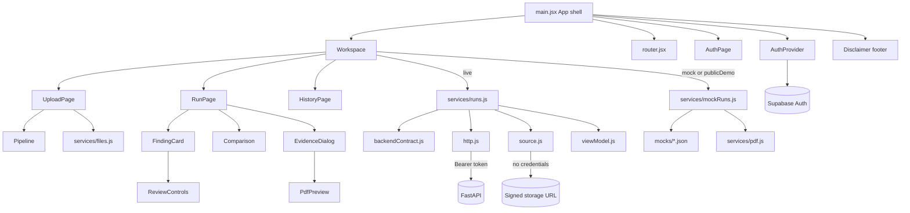
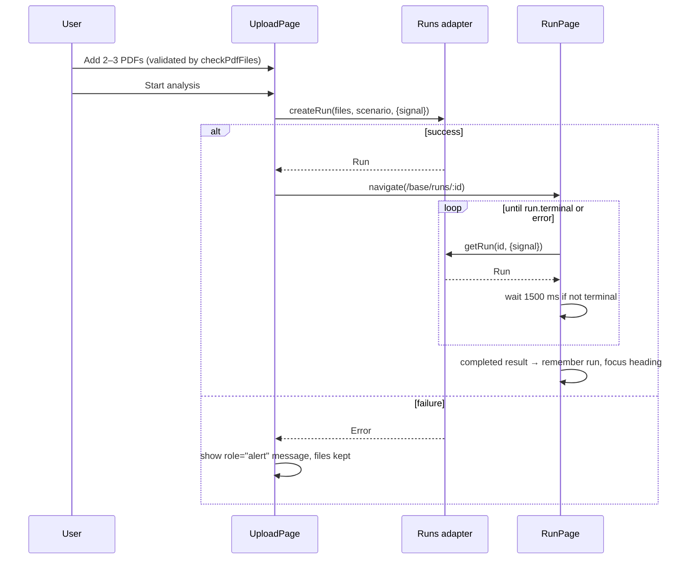

# Design Document: regulens-frontend

## Overview

The BioLyze frontend is a single-page React app in `frontend/` that uploads 2–3 PDF files to `POST /analyze`, validates the response, and renders either a severity-grouped findings dashboard (Completed_Result) or an extraction-only view (Extracted_Only_Result). It supports JSON download, rerun with different files, a counts-only comparison of two completed runs, and a Mock_Mode that returns one of two local fixtures.

Design principles visible in the code:

- **Contract isolation.** The UI talks to a semantic adapter (`createRun`, `getRun`, `listRuns`, `getSource`, `saveReview`). Two adapters exist: a session-only mock (`services/mockRuns.js`) and a live FastAPI adapter (`services/runs.js`). The live adapter refuses to send unconfirmed requests until `services/backendContract.js` is filled in and `confirmed: true` is set.
- **No fabricated results.** Live failures never fall back to mock data; mock data is always labeled "Demo"; the mock never claims to analyze uploaded content.
- **Plain-text rendering.** All backend and fixture values are rendered as JSX text; there is no `dangerouslySetInnerHTML` anywhere.
- **Token hygiene.** The Supabase access token is fetched per request, sent only as a Bearer header to relative FastAPI paths, never placed in URLs, and never sent to signed storage URLs.

Contract sources: root `README.md` (findings contract) and `frontend/CONTRACT-PENDING.md` (run, source, and review integration boundary).

## Architecture

### Stack

| Concern | Choice (as installed) |
|---|---|
| UI | React 19.2.3, React DOM 19.2.3, plain JavaScript (`.jsx`/`.js`) |
| Build | Vite 7.3.0; `vite.config.js` registers only `@tailwindcss/vite` (no `@vitejs/plugin-react`; each JSX module imports `React` explicitly, so there is no Fast Refresh) |
| Styling | Tailwind v4 imported in `src/style.css` (`@import "tailwindcss";`), but the UI is styled with hand-written semantic classes and CSS custom properties in the same file, not Tailwind utilities |
| Routing | Hand-written History API router in `src/router.jsx` |
| Auth | `@supabase/supabase-js` (^2.118.0): email/password and Google OAuth |
| PDF | `pdfjs-dist` (^6.4.299) legacy build, rendered to `<canvas>` |
| HTTP | Native `fetch`, `FormData`, `AbortController` |
| Tests | Node's built-in `node:test` + `node:assert/strict` |

Dev server: `vite --host 127.0.0.1 --port 5173 --strictPort` (keeps the CORS origin from A3 stable).

### File structure

```
frontend/
├── .env.example            # VITE_API_BASE_URL, VITE_USE_MOCK=true, VITE_SUPABASE_URL, VITE_SUPABASE_PUBLISHABLE_KEY
├── index.html              # title, theme-color, favicon = /assets/regulens-logo.png
├── vite.config.js          # tailwindcss() plugin only
├── CONTRACT-PENDING.md     # backend integration boundary (source of truth for unconfirmed items)
├── DEVELOPMENT.md          # run/verify instructions
├── public/assets/          # regulens-logo.png + README for optional assets
└── src/
    ├── main.jsx            # App shell, header, route guard, logout, footer disclaimer
    ├── router.jsx          # navigate(), useRoute(), <Link>
    ├── Workspace.jsx       # Workspace nav + UploadPage, RunPage, HistoryPage
    ├── components.jsx      # Icon, Disclaimer, FindingCard, Comparison
    ├── ReviewWorkspace.jsx # text(), Pipeline, ReviewControls, EvidenceDialog
    ├── PdfPreview.jsx      # PDF.js page renderer with page navigation and text layer
    ├── api.js              # env reads, validateResponse, severity helpers, serializeReport, legacy analyze()
    ├── brand.js            # brandAssets (logo, optional pipeline image)
    ├── style.css           # all styling + brand tokens
    ├── auth/
    │   ├── AuthProvider.jsx  # Supabase client, session context, getAccessToken, signOut
    │   ├── AuthPage.jsx      # /login and /signup forms, Google button, demo entry
    │   └── google.js         # googleEnabled(), beginGoogleSignIn()
    ├── services/
    │   ├── backendContract.js # pending mapping config (confirmed:false)
    │   ├── http.js            # createHttp(): authenticated FastAPI request, ApiError
    │   ├── runs.js            # createRunsApi(): live adapter
    │   ├── source.js          # fetchSourcePdf(): signed-URL grant flow
    │   ├── viewModel.js       # validateRun(): internal Run invariants
    │   ├── mockRuns.js        # createMockRunsApi(): in-memory demo adapter
    │   ├── files.js           # checkPdfFiles(), FILE_LIMIT
    │   └── pdf.js             # makeDemoPdf(), demoDocumentLines, demoFiles()
    ├── mocks/
    │   ├── flawed.json        # 3 findings (high, medium unsupported_claim, low)
    │   └── corrected.json     # 0 findings
    ├── api.test.js
    ├── auth/google.test.js
    └── services/services.test.js
```

### Routes

| Path | Access | View |
|---|---|---|
| `/` | any | Redirects to `/app` if signed in, else `/login` |
| `/login`, `/signup` | public | `AuthPage` (redirects to `/app` when a session exists) |
| `/app` | session required | `Workspace` → `UploadPage` |
| `/app/history` | session required | `Workspace` → `HistoryPage` |
| `/app/runs/:id` | session required | `Workspace` → `RunPage` |
| `/demo`, `/demo/history`, `/demo/runs/:id` | public | `Workspace` with `publicDemo` (always the mock adapter) |
| anything else | any | "Page not found" |

Protected routes redirect to `/login` once auth loading finishes with no user. Production hosting must rewrite these paths to `index.html`.

### Component diagram



### Run flow



## Components and Interfaces

### `src/main.jsx` (App shell)

- Wraps the app in `AuthProvider`; reads the route with `useRoute()`.
- Header: brand link (logo from `brandAssets.logo`), and on the right either the user's email plus "Log out", a "Sign in" link on demo routes, or a "RESEARCH WORKSPACE" tag.
- Logout is guarded by a ref lock, shows "Closing your workspace…" while signing out, and on failure shows the error in `role="alert"`.
- `Workspace` is keyed by `public-demo` or `${user.id}-${mock|live}`, so all in-memory run state resets when the user or mode changes.
- While auth restores: "Restoring your session…" (`role="status"`).
- Every view ends with `<Disclaimer/>` and a bottom brand strip ("ReguLens AI", "Built for a more considered review.", "HACKACHUSETTS 2026").

### `src/router.jsx`

- `navigate(path, {replace})` rejects anything not starting with a single `/` ("Invalid application route"), updates history, and dispatches `regulens:navigate`.
- `useRoute()` returns `window.location.pathname`, updated on `popstate` and `regulens:navigate`.
- `<Link to>` renders a real `<a href>` and intercepts unmodified left clicks.

### `src/api.js` (shared contract helpers)

Environment reads (module scope):

```js
export const API_BASE_URL = (import.meta.env?.VITE_API_BASE_URL || 'http://localhost:8000').replace(/\/+$/, '');
export const MOCK_MODE = import.meta.env?.VITE_USE_MOCK === 'true';
```

| Export | Behavior |
|---|---|
| `groups` | `['high','medium','low','Other']` |
| `severityGroup(value)` | `String(value).toLowerCase()` if it is `high`/`medium`/`low`, else `'Other'`. No whitespace trimming. |
| `counts(result)` | `{high, medium, low, Other}` counts over `result.findings` |
| `validateResponse(body)` | Returns `body` or throws (see below) |
| `serializeReport(result)` | `JSON.stringify(result, null, 2)` |
| `analyze(files, fixture, options)` | Legacy `POST /analyze` client. Not called by any UI path; retained for tests and as a reference for the original contract. |

`validateResponse(body)` throws `"Response format not recognized"` when:

- `body` is not a non-array object;
- `status === "completed"` and `documents_analyzed` is not a non-negative integer, `findings` is not an array, any finding is not a plain object, or a finding's non-null `sources` is not an array of plain objects;
- `status === "extracted_only"` and `documents` is not an array whose every element is an object with an array `pages`.

Any other `status` throws `` `Unsupported response status: ${JSON.stringify(body.status) ?? 'undefined'}` `` (so string values appear quoted, e.g. `"pending"`).

`analyze()` legacy behavior: mock path waits 650 ms and returns a `structuredClone` of the chosen fixture; live path posts `FormData` (`files` field) to `${API_BASE_URL}/analyze`, adds `Authorization: Bearer` only when `options.accessToken` is given, and maps network errors, non-2xx (`HTTP <status>: <detail|statusText>`), and bad JSON to thrown errors.

### `src/auth/`

**`AuthProvider.jsx`**

- Creates one Supabase client at module load when both `VITE_SUPABASE_URL` and `VITE_SUPABASE_PUBLISHABLE_KEY` are set, with `persistSession`, `autoRefreshToken`, `detectSessionInUrl` enabled. Construction errors set `configurationError`.
- Context value: `{client, configured, configurationError, session, user, loading, error, getAccessToken, signOut}`.
- Subscribes to `onAuthStateChange`; ignores a stale initial `getSession()` result if an auth event arrived first (version counter).
- `getAccessToken()` returns the current access token or `null`; throws a readable error if Supabase reports one.
- `signOut()` uses `scope: 'local'` and clears the session.

**`AuthPage.jsx`** (`signup` prop selects mode)

- Heading focus on mount; redirects to `/app` once a user exists.
- Email/password form. Sign-up passes `emailRedirectTo: ${origin}/login`, requires `minLength=8`, and handles both immediate-session and confirmation-required responses with a `role="status"` message.
- "Continue with Google": checks `googleEnabled()` first and disables itself with a setup note when the provider is off.
- All controls are disabled when Supabase is not configured, with an explanatory note.
- Link to `/demo` with "Demo mode does not create an account or analyze your uploaded documents."

**`google.js`**

- `googleEnabled({url, key, signal, fetchImpl})` → `GET ${url}/auth/v1/settings` with `apikey` header → `settings.external?.google === true`.
- `beginGoogleSignIn(client, origin)` → `signInWithOAuth({provider:'google', options:{redirectTo:`${origin}/login`}})`.

### `src/services/` (integration layer)

**Adapter interface** (shared by mock and live):

```js
{
  mode: 'mock' | 'live',
  createRun(files, scenario, { signal }) -> Promise<Run>,
  getRun(id, { signal })                 -> Promise<Run>,
  listRuns({ signal })                   -> Promise<Run[]>,
  getSource(runId, documentId, { signal }) -> Promise<Blob /* application/pdf */>,
  saveReview(runId, findingId, review, { signal }) -> Promise<Review>,
}
```

**`backendContract.js`** — a configuration object, currently `confirmed: false`:

| Key | Current value |
|---|---|
| `uploadField` | `'files'` (inherited; needs reconfirmation for `POST /runs`) |
| `createPath` | `'/runs'` (confirmed) |
| `detailPath`, `historyPath`, `reviewPath` | `null` |
| `sourceConfirmed` | `true` |
| `sourcePath(runId, documentId)` | `/documents/${encodeURIComponent(documentId)}/source` (confirmed) |
| `decodeRun`, `decodeHistory`, `encodeReview`, `decodeReview` | `null` |

**`http.js`** — `createHttp({getAccessToken, fetchImpl, baseUrl})` returns `request(path, {body, method, signal, pdf})`:

- Rejects absolute or protocol-relative paths before any token is read.
- Fetches a fresh token per call; missing token → `ApiError(…, 401)` without sending.
- Sets `Authorization: Bearer <token>`; sets `Content-Type: application/json` only for non-`FormData` bodies.
- Always `cache: 'no-store'`, `redirect: 'error'`.
- Errors: network → "The application API could not be reached. Please retry."; 401 → "Your session was rejected. Please sign in again."; 403 → "You do not have access to this resource."; other non-2xx → `HTTP <status>: <detail>` (non-string `detail` is `JSON.stringify`-ed; fallback `statusText`, then "Request failed"). `ApiError.status` carries the code.
- `pdf: true` verifies the `%PDF-` signature and returns an `application/pdf` Blob; 204 → `null`; otherwise parses JSON or throws "Response format not recognized".

**`runs.js`** — `createRunsApi({getAccessToken, contract, fetchImpl})`:

- `ready(key)` throws "Live run integration is waiting for the backend contract. Use the labeled demo workspace to preview this flow." unless `contract.confirmed` and the needed key exist. No request is sent in that case.
- `createRun` posts `FormData` (each file under `contract.uploadField`) to `createPath`, then `validateRun(decodeRun(raw))`.
- `getRun` / `listRuns` use `detailPath` / `historyPath` with their decoders; `listRuns` requires an array.
- `saveReview` sends `PATCH reviewPath(id, findingId)` with `encodeReview(review)` and decodes the response. The PATCH method is assumed; it is not yet confirmed.
- `getSource` works independently of `confirmed` (gated by `sourceConfirmed`) and delegates to `fetchSourcePdf`.

**`source.js`** — `fetchSourcePdf(request, documentId, {path, signal, fetchImpl})`, at most two attempts:

1. Request a grant from FastAPI (Bearer token). The grant must have `document_id === documentId`, string `filename`, finite positive `expires_in`, and a parseable `url`.
2. The URL must be `https:` with no embedded credentials.
3. Download with `credentials:'omit'`, `referrerPolicy:'no-referrer'`, `cache:'no-store'`, `redirect:'error'`, and no Authorization header.
4. 401/403 on the first attempt → request a new grant and retry once; otherwise show "The source link was rejected or expired. Please retry to request a fresh link."
5. Verify the `%PDF-` signature.

**`viewModel.js`** — `validateRun(run)` enforces the internal Run shape (see Data Models) and that a non-null `result` is a validated **completed** response on a **terminal** run.

**`mockRuns.js`** — `createMockRunsApi({now, id})`, an in-memory `Map` store:

- `createRun(files, scenario)`: clones `corrected.json` for `'corrected'`, otherwise `flawed.json`; overwrites `documents_analyzed` with `files.length`; rewrites `.txt` source filenames to `.pdf`; documents get ids `${runId}-document-${i}`.
- Time-based lifecycle computed on each read: `queued` → `processing` at ≥350 ms → terminal at ≥3500 ms. Terminal is `completed` (result, `method: 'Deterministic fixture · no live analysis'`, `fallback: false`) or, for `'failure'`, `failed` with one illustrative document error and `result: null`.
- `listRuns` returns newest first. `saveReview` requires a completed run containing the finding id and a status in `unreviewed | reviewed | needs_clarification`.
- `getSource` builds a synthetic PDF from `demoDocumentLines[filename]`. In the corrected scenario, `scientific-summary.pdf` is regenerated with 0.91 and an internal-only limitation line. Unknown filenames throw "No fixture source matches this filename. Demo mode does not analyze uploaded PDF contents."
- All data is lost on refresh.

**`files.js`** — `checkPdfFiles(incoming, existing)` (async). For each file, in order: `.pdf` extension (case-insensitive), size ≤ `FILE_LIMIT` (10 × 1024 × 1024), first 5 bytes equal `%PDF-`, then the 3-file cap. Returns `{files, errors}` with duplicate messages removed. Duplicate files are not detected.

**`pdf.js`** — `makeDemoPdf(lines)` writes a minimal valid single-page Helvetica PDF (non-ASCII → `?`, lines wrapped at ~78 chars). `demoDocumentLines` holds three fictional documents (`scientific-summary.pdf`, `model-validation.pdf`, `results-table.pdf`), and `demoFiles()` turns them into `File` objects.

### `src/Workspace.jsx`

`Workspace({path, publicDemo})`:

- `mock = publicDemo || MOCK_MODE`. The adapter is `createMockRunsApi()` or `createRunsApi({getAccessToken})`, memoized.
- `base` is `/demo` or `/app`. Nav: "New analysis", "Analysis history", and a mode tag ("Demo adapter" / "FastAPI workspace").
- Mock → "DEMO WORKSPACE" notice (illustrative states and findings, uploads not analyzed, data lasts until refresh). Live with an unconfirmed contract → "Backend contract pending." note.
- Keeps `successful` (completed runs seen this session) for comparison.
- `ErrorMessage` renders `role="alert"`; for `status === 401` it adds a "Sign in again" button that signs out and goes to `/login`.

**`UploadPage`**

- Intro: eyebrow "EVIDENCE INTEGRITY REVIEW", `<h1>` "Clarity in every claim.". Optional pipeline image from `brandAssets.pipeline`.
- Upload panel: `<h2>` "Add PDF documents for review", `n / 3 documents` chip, and the description "Scientific summary, model validation report, and results table. PDF only."
- Mock only: "DEMO SCENARIO" `<select>` labeled "Sample" with Flawed package / Corrected package / Document processing error (default `flawed`, user-changed only), plus a "Load sample PDFs ↗" shortcut that replaces the selection with `demoFiles()`.
- Drag-and-drop dropzone plus a visually hidden `<input type="file" multiple accept=".pdf,application/pdf" aria-label="Choose PDF documents">` opened by "browse files". The input value resets after each change.
- File list: name, `max(1, round(size/1024)) KB · PDF`, and a remove button with `aria-label="Remove <name>"`.
- Errors in `role="alert"`. Status line in `role="status"`: "Checking PDF files…", "Submitting evidence package…", "Select at least 2 PDF documents to begin.", or "Your package is ready for review."
- "Start analysis" is disabled while checking, while submitting, or with fewer than 2 files. A ref lock prevents double submission. Success navigates to the run page. Unmount aborts the request.
- `<Pipeline busy>`: a four-step workflow overview (Prepare package, Process evidence, Inspect findings, Record your review).

**`useRun(api, id)`** — sequential polling: `getRun`, then `setTimeout(load, 1500)` while `!run.terminal`. It stops on terminal state or error and aborts on unmount. `retry()` restarts it.

**`RunPage`**

- `<h1 tabIndex={-1}>` "Analysis progress", or "Your evidence, in focus." once a result exists. It is focused on mount and again when a completed result arrives. The eyebrow is prefixed "DEMO DATA · " in mock mode.
- Polling error → `ErrorMessage` plus "Retry status request".
- Status pill (`role="status"`) with a spinner while non-terminal. Details: Run ID, Created, Last updated, Completed (if any), Analysis method, Fallback used. The last two show "Not reported" when null.
- "Documents in this run" (`<h2>`): each document with its optional status and matching document errors. Unmatched errors are listed separately.
- Terminal without result: "This run has no completed findings report…"
- With result: `<h2>` "Findings summary", "Download JSON report", and stats for Documents analyzed, Total findings, and each non-zero severity count.
  - Zero findings: `<h2>` "No findings were flagged in the uploaded package" + "This result is not a compliance certification. Human review remains necessary."
  - Otherwise, severity sections in `groups` order, each `<h3>` "High priority" / "Medium priority" / "Low priority" / "Other findings" with a count chip, then `FindingCard`s. Original finding order is kept within a group.
  - `Comparison` when an earlier completed run with a result exists in `successful` (the latest one whose `createdAt` precedes the current run's).
- Download: Blob of `serializeReport(run.result)` → object URL → `<a download="regulens-report.json">` click → revoke after 1 s. Review notes are not included.
- Inspect source: matches `run.documents` by `source.document_id` if present, else by `filename`; exactly one match is required, otherwise the dialog explains the ambiguity.
- Review save: needs `finding.id` (otherwise "A backend finding ID is required to save this review."). Shows per-finding busy/messages ("Unsaved changes", "Saved in demo session" / "Review saved", "Not saved: …"). Unmount aborts pending saves.

**`HistoryPage`** — `<h1>` "Analysis history" (focused on mount), "Refresh history", loading/error states, an empty state ("Your first review starts here."), and a list of runs (status, filenames, date, finding count or "No completed report", run id, "Open run").

### `src/components.jsx`

- `display(value)`: null/empty → "Not provided"; objects → pretty JSON; otherwise `String`.
- `Icon({name, size})`: inline SVG, `aria-hidden`.
- `Disclaimer`: `<footer>` stating a preliminary evidence-integrity audit, not an FDA approval prediction or regulatory compliance certification; severity is a triage label, not a regulatory risk determination; demo documents are synthetic and fictional.
- `FindingCard({finding, onInspect, review, onReview, onSaveReview, reviewSaving, reviewMessage})` as an `<article>`:
  - Meta row: severity badge (raw value, color class from `severityGroup`), `id` (monospace), `type` with underscores replaced by spaces.
  - `<h4>` title, optional "Category: …", explanation.
  - `review_required === true` → "◉ Human review required".
  - `type === 'unsupported_claim'` → "Supporting evidence was not found in the uploaded package; this does not prove that evidence does not exist."
  - Sources: filename, "Page n" or "Page not provided", `<blockquote>` (CSS `white-space: pre-wrap`) with the quote or "Quote not provided", and an "Inspect source ↗" button. Empty or missing → "No source citation provided".
  - Non-null `guidance_reference` → "Guidance reference" + `<pre>` of the value. There is no draft-guidance label (pending A7).
  - "Recommended action" + action text, then `ReviewControls`.
- `Comparison({previous, current})`: `<h3>` "How the package changed", two columns (PREVIOUS RUN / CURRENT RUN), each with findings and document counts, per-group counts, and filenames, plus "Counts only. Issue-level comparison requires a stable issue identity guaranteed by the Backend." Collapses to one column under 640 px.

### `src/ReviewWorkspace.jsx`

- `text(value)`: same rules as `display`.
- `ReviewControls`: a labeled "Review status" `<select>` (Unreviewed / Reviewed / Needs clarification), a labeled "Reviewer note" `<textarea>` (`maxLength` 10000), "Save review" (disabled without `onSave`), a `role="status"` message, and the note "Personal review only. “Reviewed” means inspected, not resolved or scientifically confirmed."
- `EvidenceDialog`: a native `<dialog>` opened with `showModal()`, labelled by its `<h2>`. Escape is routed to `onClose`, and focus returns to the previously focused element. It shows the citation filename, page, and response quotation separately from the source. It loads the PDF through `api.getSource` (abortable, object URL revoked on close) and offers "Retry source retrieval" on error, an "Open PDF in another tab ↗" link (`#page=n`), and `PdfPreview` at the cited page (default 1).

### `src/PdfPreview.jsx`

- Lazy-imports `pdfjs-dist/legacy/build/pdf.mjs`, uses the bundled worker URL, and sets `isEvalSupported: false`.
- Previous/Next buttons and a numeric page input (clamped). A note appears when the cited page exceeds the page count.
- Renders to a `<canvas role="img">` sized from a `ResizeObserver` (max 1000 px CSS width, device-pixel ratio capped at 2). Extracted page text is shown in a `<details>` "Read extracted page text".
- Render errors appear in `role="alert"`. Tasks are cancelled or destroyed on change or unmount.

### Styling, branding, accessibility

- Brand tokens in `style.css`: primary teal `#087E8B`, secondary lavender `#8B87B8`, navy `#102A43`, and a teal → cyan → lavender accent gradient on the header and auth card. Serif (Georgia) display headings, Inter body.
- Content column `main { max-width: 1000px }`. Breakpoints at 640 px and 760 px stack layouts. `overflow-wrap:anywhere` is applied to long values.
- Focus: `:focus-visible` outline 3 px `#087E8B` on buttons, links, inputs, selects, and `[tabindex]`. `prefers-reduced-motion` disables animation.
- Every interactive control is a native `<button>`, `<a>`, `<input>`, `<select>`, `<textarea>`, or `<dialog>`. The hidden file input has an `aria-label`; remove buttons name their file.
- Heading levels: `h1` page title (upload intro, run title, history, auth intro), `h2` sections (upload panel, documents, findings summary, auth card), `h3` severity groups and comparison, `h4` finding titles.
- Severity uses a text badge and heading text, with color only as an extra cue.

## Data Models

```js
// Internal Run view model (NOT a wire schema; see CONTRACT-PENDING.md)
Run = {
  id: string,                         // required, non-empty
  status: string,                     // raw display string
  terminal: boolean,                  // explicit; mapped from agreed lifecycle
  createdAt?: string, updatedAt?: string, completedAt?: string, // ISO timestamps
  documents: [{ id: string, filename: string, status?: any }],
  documentErrors: [{ documentId?: string, filename?: string, message: string }],
  method?: any, fallback?: any,       // shown as "Not reported" when null
  result: CompletedResult | null,     // only on terminal runs
  reviews?: { [findingId]: Review },
  demo?: true,                        // mock adapter only
}

Review = { status: 'unreviewed' | 'reviewed' | 'needs_clarification', note: string }

// Findings response (root README contract)
CompletedResult = { status: 'completed', documents_analyzed: int >= 0, findings: Finding[] }
ExtractedOnlyResult = { status: 'extracted_only', documents: [{ filename, pages: [{ page, text }] }], findings: [] }
Finding = { id, type, severity, title, explanation, sources: [{ filename, page, quote, document_id? }],
            guidance_reference, action, review_required, category? }

// Source grant (confirmed): GET /documents/{document_id}/source
SourceGrant = { document_id: string, filename: string, url: 'https://…', expires_in: number > 0 } // 60 s
```

`document_id` on a source and `category` on a finding are optional extensions the UI uses when present.

Fixtures:

- `flawed.json`: `documents_analyzed: 3`. ISSUE-001 `metric_mismatch`/high (two sources: sensitivity 0.81 vs 0.91), ISSUE-002 `unsupported_claim`/medium (one source), ISSUE-003 `missing_documentation`/low (no sources). All `guidance_reference: null`, all `review_required: true`. Filenames end in `.txt`; the mock adapter rewrites them to `.pdf`.
- `corrected.json`: `documents_analyzed: 3`, `findings: []`.

State ownership:

| State | Owner | Lifetime |
|---|---|---|
| Supabase session | Supabase SDK | Persisted by the SDK (browser storage), auto-refreshed |
| Selected files, upload errors, scenario | `UploadPage` | Until navigation away |
| Current run, drafts, review save states | `RunPage` | Until navigation away; re-fetched from the adapter on reopen |
| `successful` runs for comparison | `Workspace` | Until refresh, mode change, or user change |
| Mock runs and reviews | `createMockRunsApi` store | Until refresh |

The app itself writes no analysis data, notes, or signed URLs to browser storage.

## Correctness Properties

*A property is a characteristic or behavior that should hold true across all valid executions of a system: a formal statement about what the system should do. Properties connect human-readable specifications to machine-verifiable correctness guarantees.*

The prototype checks these with example-based `node:test` cases, not generated (property-based) inputs. The "Covered by" line names the current test.

### Property 1: File selection invariants

*For any* existing selection and incoming files, `checkPdfFiles` returns at most 3 files, each with a `.pdf` name, size ≤ 10 MiB, and a `%PDF-` header. It returns one de-duplicated error per rejection reason and file. Submission is possible only with 2–3 accepted files.

Covered by: `services.test.js` "PDF selection excludes TXT, renamed non-PDFs, oversized files, and a fourth PDF".

**Validates: Requirements 1.4, 1.5, 1.6, 1.7, 1.8, 1.9**

### Property 2: Response classification never promotes non-completed bodies

*For any* JSON value, `validateResponse` returns it unchanged only for a well-formed `completed` or `extracted_only` body and throws for everything else. `validateRun` accepts a non-null `result` only when it validates as `completed` and the run is terminal.

Covered by: `api.test.js` "completed and extraction-only results stay distinct", "malformed responses cannot masquerade as successful audits"; `services.test.js` "view mapping rejects partial reports and invalid documents".

**Validates: Requirements 3.1, 3.2, 3.3, 3.4, 3.5, 3.6, 3.7**

### Property 3: Severity grouping is an ordered partition

*For any* findings, each finding lands in exactly one of `high, medium, low, Other` (case-insensitive match; anything else is Other). Group counts sum to `findings.length`, sections render in that order, and empty groups are hidden.

Covered by: `api.test.js` "severity grouping preserves unknown severities and export is lossless" (counts only; rendering order is not tested).

**Validates: Requirements 6.1, 6.2, 6.3, 6.4**

### Property 4: Quotation integrity

*For any* source, the quote is rendered as a single JSX text child, character for character, with whitespace preserved by CSS. No HTML is interpreted, and only response-provided sources are shown.

Covered by: none automated (code review only: no `dangerouslySetInnerHTML` in `src/`).

**Validates: Requirements 7.3, 7.4, 7.5, 14.2**

### Property 5: JSON export round trip

*For any* completed result, `JSON.parse(serializeReport(result))` deeply equals `result`, including unknown extra fields. Review notes are never part of the export.

Covered by: `api.test.js` "severity grouping preserves unknown severities and export is lossless".

**Validates: Requirements 9.2, 9.3, 9.4**

### Property 6: Live failures never yield mock data

*For any* live failure (unconfirmed contract, network error, non-2xx, bad JSON, invalid mapping), the live adapter throws and sends no speculative request. Mock data is reachable only through the mock adapter, which is chosen by `publicDemo || MOCK_MODE` and always labeled Demo.

Covered by: `api.test.js` "HTTP, JSON, network failures remain errors rather than demo results", "mock fixture selection is explicit and never sends a request"; `services.test.js` "pending contract blocks speculative API calls", "HTTP 401 and 403 are actionable without substituting mock data".

**Validates: Requirements 5.1, 5.2, 5.3, 5.4, 5.5, 11.2, 11.6, 17.1**

### Property 7: Bearer token confinement

*For any* request, the access token is read fresh, sent only as an `Authorization` header to a relative FastAPI path, never appears in a URL, and is never attached to a signed storage download.

Covered by: `services.test.js` "all API methods require a token and retrieve a current token per request", "the token cannot be sent to an arbitrary absolute source URL", "authenticated PDF retrieval verifies bytes and leaves the token out of the URL", "source contract gets a fresh signed grant for every open without leaking the bearer token".

**Validates: Requirements 14.5, 14.6, 14.7, 18.4**

### Property 8: Source grant integrity

*For any* grant, the PDF is downloaded only if the grant's `document_id` matches, the URL is HTTPS without credentials, and the bytes start with `%PDF-`. An expiry rejection is renewed at most once.

Covered by: `services.test.js` "expired signed links are refreshed once without retrying indefinitely", "source grants reject wrong document IDs and insecure URLs".

**Validates: Requirements 18.3, 18.5, 18.6**

## Error Handling

| Condition | Source | Message shown | Effect |
|---|---|---|---|
| Non-PDF extension | `checkPdfFiles` | "<name>: only PDF documents are supported." | File not added |
| Over 10 MB | `checkPdfFiles` | "<name>: exceeds the 10 MB per-file limit." | File not added |
| Missing `%PDF-` header | `checkPdfFiles` | "<name>: the file does not have a readable PDF header." | File not added |
| More than 3 files | `checkPdfFiles` | "A maximum of 3 PDF documents can be selected." | Extra files dropped |
| File read failure | `UploadPage` | "Could not read one of the selected files. Please choose it again." | Selection unchanged |
| Fewer than 2 files | `UploadPage` | "Select at least 2 PDF documents to begin." (status) | Start disabled |
| Live contract unconfirmed | `runs.js` | "Live run integration is waiting for the backend contract. Use the labeled demo workspace to preview this flow." | No request sent |
| No token | `http.js` | "Your session has expired. Please sign in again." (401) | No request sent |
| Network error | `http.js` | "The application API could not be reached. Please retry." | Files or run state kept |
| HTTP 401 | `http.js` | "Your session was rejected. Please sign in again." + "Sign in again" button | — |
| HTTP 403 | `http.js` | "You do not have access to this resource." | — |
| Other non-2xx | `http.js` | "HTTP <status>: <detail or statusText>" | — |
| Bad JSON | `http.js` | "Response format not recognized" | — |
| Invalid run mapping | `viewModel.js` | "Run response mapping is incomplete. Check the agreed backend contract." / "A completed report requires a terminal run." | — |
| Polling failure | `RunPage` | Error text + "Retry status request" | Polling stops |
| Ambiguous source document | `EvidenceDialog` | "A unique source document could not be identified…" | No fetch |
| Bad grant / insecure URL / non-PDF | `source.js` | Specific message + "Retry source retrieval" | — |
| PDF render failure | `PdfPreview` | "Unable to render PDF: …" / "Unable to render this page: …" | — |
| Review save failure | `RunPage` | "Not saved: <message>" | Draft kept |
| Supabase misconfigured | `AuthProvider` | Configuration note; controls disabled | Demo link still available |
| Google provider off | `AuthPage` | "Google sign-in is being configured. You can continue with email." | Button disabled |
| Sign-out failure | `main.jsx` | Error message or "Sign-out failed. Please retry." | Session kept |

There is no automatic retry except the single signed-URL renewal and status polling of non-terminal runs. No request timeout exists, and nothing ever falls back to mock data.

## Testing Strategy

- Runner: `npm test` → `node --test src/api.test.js src/services/services.test.js src/auth/google.test.js`. 23 tests, all passing as of commit `21d1321`. `npm run build` also succeeds.
- Tests inject `fetchImpl`, `getAccessToken`, `now`, and `id`, so no network or browser is needed. JSON fixtures are imported with `with { type: 'json' }`, and `import.meta.env?.` is optional-chained so modules load under Node.
- Not covered: React component rendering, routing, focus management, `EvidenceDialog`/`PdfPreview`, and `AuthProvider`. There are no property-based tests and no DOM test environment (jsdom/Testing Library are not installed).
- Manual checks before the demo: keyboard pass through `/demo` (upload → run → inspect source → save review → history → reopen), focus lands on each page's `h1`, 320 px and 1920 px widths without horizontal scroll, contrast spot-check, and a sign-in/sign-out cycle against the configured Supabase project. Full WCAG validation needs assistive-technology testing beyond this prototype.

## Changes from the Original MVP Scope

The first version of `requirements.md` described a seven-hour single-page MVP. The prototype grew beyond it. `requirements.md` now reflects the prototype; this table records what changed and why the requirement numbers mean something different from the original draft.

| Area | Original MVP | Prototype (current requirements) |
|---|---|---|
| Scope | No auth, router, or navigation (Scope) | Supabase auth, custom router, workspace nav, history |
| Endpoint | `POST /analyze` (A1, Req 2.1) | `POST /runs` through the contract adapter, Bearer token; `/analyze` client kept but unused by UI |
| File types | `.pdf` and `.txt` (Req 1.1, 1.4) | PDF only, plus a `%PDF-` signature check |
| Loading | "Analyzing documents" live region (Req 4.1–4.2) | "Submitting evidence package…" status, then a polled run status pill |
| Error text | "<detail> (HTTP n)", "Could not reach the backend at…" (Req 5.1–5.3) | "HTTP n: <detail>", "The application API could not be reached. Please retry." |
| Extraction-only | Dedicated view (Req 3.5, 8.1–8.2) | Not rendered; `validateRun` only accepts completed results |
| Rerun | "Run again with different files", "Clear results" (Req 10.1, 10.2, 10.8) | "New analysis" link and history; runs are separate pages |
| Comparison | Previous/current pair (Req 10.3–10.5) | Latest earlier completed run in the session, shown below findings |
| Mock labels | "Flawed sample" / "Corrected sample" (Req 11.3) | "Flawed package" / "Corrected package" / "Document processing error"; plus public `/demo` |
| Mock results | Fixture returned as-is | `documents_analyzed` set to the file count, `.txt` → `.pdf` filenames |
| Disclaimer | Banner at top (Req 12.1) | Footer at the bottom of every view |
| Results heading | Focus "Results summary" (Req 13.5) | Focus run `h1` ("Your evidence, in focus.") |
| Storage | No browser storage (Req 14.1) | Supabase SDK persists the session; app data stays in memory |
| Env vars | Only two (Req 14.3–14.4) | Four, including public Supabase URL and publishable key; `.env.example` defaults `VITE_USE_MOCK=true` |
| Styling | Tailwind utilities | Custom CSS classes and tokens |
| Added features | — | Review notes, source PDF viewer, signed-URL source contract, Google OAuth, run lifecycle and polling, run metadata (method, fallback) |

## Known Gaps and Observations

Found while reverse-engineering, not yet addressed in code:

1. **Extraction-only responses have no UI.** `validateResponse` accepts them, but `validateRun` rejects any non-completed `result`, and the `.extracted` CSS classes are unused.
2. **Severity whitespace.** `severityGroup(" high")` returns `Other` because values are not trimmed.
3. **Mock with user-uploaded PDFs.** Findings still cite the fixture filenames (`scientific-summary.pdf`, …), so "Inspect source" cannot match a document unless the sample PDFs were loaded.
4. **`api.analyze()` is dead code in the UI.** It is exercised only by `api.test.js`.
5. **Review save method.** `PATCH` is hardcoded in `runs.js` although the review path and method are unconfirmed.
6. **Dependency ranges.** `@supabase/supabase-js`, `pdfjs-dist`, `tailwindcss`, and `@tailwindcss/vite` use caret ranges. React and Vite are pinned.
7. **No Fast Refresh.** `@vitejs/plugin-react` is not configured.

## Unresolved Backend Dependencies

From `CONTRACT-PENDING.md`. These must be agreed with the tech lead before `backendContract.confirmed` becomes `true`:

1. **Run create**: confirm multipart field (`files`), count and size limits (2–3, 10 MB), and the create response schema → `decodeRun`.
2. **Run detail and history**: paths, schemas, pagination, lifecycle values and which are terminal, timestamp semantics → `detailPath`, `historyPath`, `decodeRun`, `decodeHistory`.
3. **Document identity and errors**: run responses must carry document IDs (needed for source lookup) and a document-error format.
4. **Result metadata**: how the analysis method and AI-failure/deterministic-fallback are reported (`method`, `fallback`).
5. **Reviews**: path, HTTP method, request and response bodies, allowed status values, 204 handling → `reviewPath`, `encodeReview`, `decodeReview`.
6. **Stable finding identity**: per-run IDs are needed to save reviews; cross-run identity is needed for issue-level comparison (comparison stays counts-only until then).
7. **`guidance_reference` format and source-identity metadata (A7)**: until agreed, values display as provided with no draft-guidance label.
8. **401/403 semantics** and owner-access enforcement in FastAPI, PostgreSQL, and Storage policies.
9. **CORS / redirects**: backend allow-list for `http://127.0.0.1:5173` and `http://localhost:5173`; Supabase redirect URLs for `/login` on each origin; SPA rewrites in production hosting.
